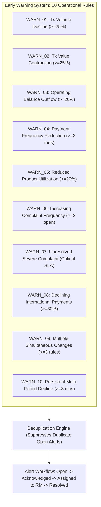

# BankRetain: Comprehensive Analytics & Mathematical Specification Guide

This guide details the mathematical formulas, domain logic, thresholds, and calculations powering the **BankRetain Corporate Banking Customer Attrition Analytics and Retention Management System**.

---

## 1. Domain Context: Corporate Banking vs. Retail Churn

In retail banking, churn is often binary (e.g., closing a checking account or credit card). In **corporate and commercial banking**, attrition is fundamentally different:

1. **Attrition is gradual:** A corporate client rarely closes all accounts overnight. Instead, they progressively migrate cash management, cross-border payments, or trade financing to a competitor.
2. **Behavioral trail:** This operational migration leaves a distinct trail: declining transaction counts, shrinking month-end operating balances, dormant credit facilities, and unresolved payment execution complaints.
3. **Regulatory & Audit Transparency:** Corporate banking credit and relationship committees cannot rely on opaque "black-box" machine learning predictions. Every warning, risk score, and retention recommendation must be **fully deterministic, transparent, and auditable**.

---

## 2. Core Mathematical Utilities (`mathUtils.js`)

All analytics in BankRetain use conventional, deterministic mathematical algorithms implemented in [`server/utils/mathUtils.js`](file:///C:/Users/P%20Yohith%20Sai/.gemini/antigravity/scratch/bankretain/server/utils/mathUtils.js).

### A. Month-over-Month (MoM) Percentage Change
Measures standard period-over-period expansion or contraction:

$$\text{Percentage Change} = \left(\frac{V_{\text{current}} - V_{\text{previous}}}{V_{\text{previous}}}\right) \times 100$$

* **Positive value:** Growth relative to previous period.
* **Negative value:** Contraction relative to previous period.

### B. Decline Percentage (Loss Convention)
Specifically calculated for attrition detection where positive values denote a decline:

$$\text{Decline Percentage} = \left(\frac{V_{\text{previous}} - V_{\text{current}}}{V_{\text{previous}}}\right) \times 100$$

* **Example:** Previous month's transaction count = 1,000; Current month = 750.
  $$\text{Decline} = \left(\frac{1000 - 750}{1000}\right) \times 100 = 25.0\%$$
* **If $V_{\text{current}} = 0$:** Decline is $100.0\%$.

### C. Safe Zero-Denominator Handling
If $V_{\text{previous}} = 0$ (e.g., a newly onboarded corporate account with no historical baseline), standard division produces a division-by-zero error ($\infty$).
* BankRetain catches this edge case safely:
  ```javascript
  if (prev === 0) return null;
  ```
* When `null` is returned, the UI renders the metric as `Unavailable / Baseline Pending`, preventing crashes and avoiding false alarms.

---

## 3. Relationship Analytics Engine (`analyticsService.js`)

Implemented in [`server/services/analyticsService.js`](file:///C:/Users/P%20Yohith%20Sai/.gemini/antigravity/scratch/bankretain/server/services/analyticsService.js).

### A. Simple Moving Averages: SMA-3 and SMA-6
To distinguish between seasonal volatility and genuine attrition trends, the system calculates 3-month and 6-month simple moving averages:

$$\text{SMA}(n) = \frac{1}{n} \sum_{i=1}^{n} V_{t - i + 1}$$

* **$\text{SMA}(3)$:** Rolling 3-month baseline for short-term trajectory.
* **$\text{SMA}(6)$:** Rolling 6-month baseline for medium-term relationship health.
* If a customer has fewer than $n$ months of history, $\text{SMA}(n)$ returns `null` until sufficient observations accumulate.

### B. Moving Average Deviation
Measures how far the current period has fallen below the 3-month rolling baseline:

$$\text{Deviation}_{\text{SMA3}} = \left(\frac{\text{SMA}(3) - V_{\text{current}}}{\text{SMA}(3)}\right) \times 100$$

* A positive deviation indicates current activity is contracting relative to the client's recent average.

### C. Transaction Analysis & Decline Thresholds
Evaluates monthly transaction volume (count) and turnover (value) across wire types (Domestic vs. International / Inbound vs. Outbound):

| Contraction Range | Operational Classification | System Response |
| :--- | :--- | :--- |
| **$< 10.0\%$ Decline** | Normal / Normal Seasonal Fluctuation | No warning generated |
| **$10.0\% \le \text{Decline} < 25.0\%$** | Moderate Decline | Flagged in analytical breakdown |
| **$\ge 25.0\%$ Decline** | High Decline | Triggers EWS Alert `WARN_01_TX_VOL` & Risk points |

### D. Operating Balance Outflow & Sustained Decline
Operating cash accounts reflect day-to-day liquidity held at the bank:

| Balance Contraction | Operational Classification | System Response |
| :--- | :--- | :--- |
| **$< 10.0\%$ Decline** | Stable Liquidity | No warning generated |
| **$10.0\% \le \text{Decline} < 20.0\%$** | Moderate Outflow | Monitored on watchlists |
| **$\ge 20.0\%$ Decline** | High Capital Outflow | Triggers EWS Alert `WARN_03_BAL` & Risk points |

* **Sustained Decline Duration:** The system counts the number of consecutive months where balance or volume experienced month-over-month contraction ($M_1 > M_2 > M_3$). $\ge 2$ consecutive months triggers the persistent decline indicator.

---

## 4. Banking Product Utilization & Service Quality

### A. Product Utilization Rate
For each credit or treasury facility (e.g., Working Capital Lines, Letters of Credit, Cash Concentration, FX Hedging):

$$\text{Utilization Rate} = \left(\frac{\text{Outstanding Balance / Drawn Amount}}{\text{Approved Credit Limit}}\right) \times 100$$

* **Trigger:** If facility utilization drops by $\ge 20\%$ or a product has no activity for 60+ days, it is marked as `Declining` or `Dormant`. In corporate banking, dropping credit facility utilization frequently indicates the client has secured credit lines with another institution.

### B. Service Complaint Severity & Escalation
Corporate clients escalate complaints when mission-critical operations fail (e.g., delayed cross-border payroll, disputed transaction fees, locked portal access):
* **Severity Levels:** Low, Medium, High, Critical.
* **Trigger:** Any open `Critical` severity complaint or $\ge 2$ unresolved standard complaints triggers an immediate risk rule.

---

## 5. Transparent Rule-Based Risk Scoring (0–100)

Implemented in [`server/services/riskScoringService.js`](file:///C:/Users/P%20Yohith%20Sai/.gemini/antigravity/scratch/bankretain/server/services/riskScoringService.js).

> [!IMPORTANT]
> **Risk Score Definition:**
> A Risk Score of 75/100 does **not** represent a 75% probability of attrition. It is a **deterministic, weighted index (0–100)** reflecting the cumulative presence of verified early-warning signals.

### Point Attribution Model

```
Total Risk Score = min(100, Points_Tx + Points_Bal + Points_Complaints + Points_Products + Points_Sustained)
```

| Rule Code | Indicator Name | Baseline Evaluated | Threshold Condition | Max Points Contributed |
| :--- | :--- | :--- | :--- | :---: |
| `RULE_TX_VOL_DECLINE` | **High Transaction Volume Decline** | Trailing monthly average count | Month-over-month decline $\ge 25.0\%$ | **30** |
| `RULE_BAL_DECLINE` | **High Operating Balance Decline** | Previous operating balance | Balance contraction $\ge 20.0\%$ | **25** |
| `RULE_COMPLAINTS_SEV` | **Repeated or Unresolved Service Complaints** | 0 open issues | $\ge 2$ open complaints OR any active `Critical` ticket | **20** |
| `RULE_PROD_UTIL_DECLINE` | **Product Utilization Contraction** | Approved facility limits | Facility utilization drop $\ge 20.0\%$ OR dormant product | **15** |
| `RULE_SUSTAINED_PAYMENT_DECLINE` | **Sustained Multi-Month Contraction** | Rolling 3-Month SMA ($\text{SMA}_3$) | $\ge 2$ consecutive declining months OR $\ge 30\%$ below $\text{SMA}_3$ | **10** |
| **Theoretical Maximum** | | | | **100** |

### Risk Categories
* **Low (0 – 29):** Stable relationship, normal fluctuations.
* **Medium (30 – 59):** Emerging operational slowdown in one key banking product.
* **High (60 – 79):** Severe dual decline (e.g. liquidity drain + volume collapse).
* **Critical (80 – 100):** Multiple compounding failures (liquidity drain, payment drop, active critical escalation).

---

## 6. Early Warning System (EWS) — 10 Warning Rules

Implemented in [`server/services/alertService.js`](file:///C:/Users/P%20Yohith%20Sai/.gemini/antigravity/scratch/bankretain/server/services/alertService.js).

The system scans data across 10 specific banking warning signals:



---

## 7. Retention Prioritization Matrix

Relationship Managers (RMs) have limited time. The system prioritizes retention outreach using a financial exposure formula:

$$\text{Priority Exposure Score} = \text{Risk Score} \times \text{Annual Corporate Revenue}$$

* A client with a Risk Score of 85 and \$50,000,000 in turnover is prioritized over a client with a Risk Score of 90 and \$2,000,000 turnover.
* Generates actionable workflows:
  * **Executive Relationship Review:** C-suite meeting with Commercial Banking MD.
  * **Liquidity Sweep Restructuring:** Tailored treasury yields to stop deposit migration.
  * **FX Fee Optimization:** Discounted spreads on international corridors.
  * **Credit Facility Expansion:** Restructured working capital terms.

---

## 8. Campaign Analytics: Randomized Controlled Trials (RCT)

Implemented in [`server/utils/mathUtils.js`](file:///C:/Users/P%20Yohith%20Sai/.gemini/antigravity/scratch/bankretain/server/utils/mathUtils.js#L117-L198).

To verify whether retention incentives actually work (or whether customers would have stayed anyway), BankRetain evaluates retention campaigns using **50/50 randomized controlled trials**:

* **Treatment Group ($N_1, R_1$):** At-risk clients who received the proactive retention intervention (e.g. fee waivers, executive visits).
* **Control Group ($N_0, R_0$):** At-risk clients held back as a baseline (standard commercial banking service).

### A. Retention Rates
$$p_1 = \frac{R_1}{N_1}, \quad p_0 = \frac{R_0}{N_0}$$

### B. Absolute and Relative Retention Lift
$$\text{Absolute Lift} = p_1 - p_0$$

$$\text{Relative Lift (\%)} = \left(\frac{p_1 - p_0}{p_0}\right) \times 100$$

### C. Pooled Two-Proportion Z-Test
To test the null hypothesis $H_0: p_1 = p_0$ (the campaign had no effect):

$$\hat{p}_{\text{pool}} = \frac{R_1 + R_0}{N_1 + N_0}$$

$$\text{SE}_{\text{pool}} = \sqrt{\hat{p}_{\text{pool}} (1 - \hat{p}_{\text{pool}}) \left(\frac{1}{N_1} + \frac{1}{N_0}\right)}$$

$$Z = \frac{p_1 - p_0}{\text{SE}_{\text{pool}}}$$

### D. P-Value Calculation
Using the standard normal cumulative distribution function (Abramowitz & Stegun polynomial approximation of the Gaussian error function):

$$\text{p-value} = 2 \times (1 - \Phi(|Z|))$$

* If $\text{p-value} < 0.05$, the retention campaign is **statistically significant** at the 95% confidence level.

### E. 95% Confidence Interval for Absolute Lift
Using unpooled standard error:

$$\text{SE}_{\text{unpooled}} = \sqrt{\frac{p_1(1 - p_1)}{N_1} + \frac{p_0(1 - p_0)}{N_0}}$$

$$\text{CI}_{95\%} = \text{Absolute Lift} \pm 1.95996 \times \text{SE}_{\text{unpooled}}$$

### F. Financial Return: Cost per Incremental Retained Customer
$$\text{Incremental Retained Clients} = \text{Absolute Lift} \times N_1$$

$$\text{Cost Per Retained Client} = \frac{\text{Campaign Budget}}{\text{Incremental Retained Clients}}$$

---

## 9. Summary Comparison: What Each Metric Tells the Banker

| Metric | What It Actually Measures | Action It Triggers |
| :--- | :--- | :--- |
| **Transaction Decline %** | Operating velocity contraction | Check billing corridors & treasury accounts |
| **Operating Balance Decline %** | Liquidity migration to competing banks | Offer competitive sweep or deposit yields |
| **SMA-3 Deviation** | Activity falling below client's recent norm | Distinguishes seasonal dip from genuine churn |
| **Facility Utilization Rate** | Client reliance on bank's credit products | Re-evaluate terms before client closes lines |
| **Risk Score (0–100)** | Cumulative early-warning index | Assigns severity tier (Low, Med, High, Critical) |
| **Priority Exposure** | Total financial capital at risk | Sorts RM outreach queue by portfolio impact |
| **Campaign Absolute Lift** | True causal impact of retention program | Justifies retention budget ROI to executive board |
